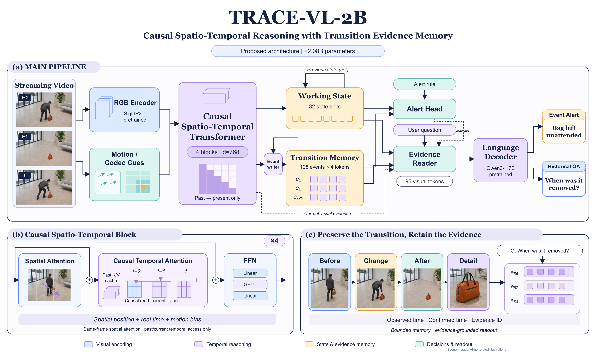

# TRACE-VL

约 2B 的因果流式视频模型研究项目：时空 Transformer、有界转移证据记忆、规则条件告警与长视频问答。

这是可训练的研究原型。`tiny` 与约 2B 配置共享时空模块、记忆、读取和任务损失；tiny 使用小型随机初始化骨干验证软件，HF 配置复用 Qwen3-1.7B 与 SigLIP2。当前没有发布真实数据集上的论文结果或训练完成的 2B 权重。

已在单张 RTX 5090 上完成现有 **2.105B** 架构的真实短视频训练试验，包含 100 步与完整一轮训练、保留视频验证和视觉错配对照，见 [本机实验报告](docs/experiments/activitynetqa_baseline_2026-11-05.md)。这是本地对齐试验，尚无官方 streaming benchmark 成绩。

双卡继续训练至 2250 步的验证 EM 为30.5%，视频错配后仍为30.5%，见 [延长训练报告](docs/experiments/ddp_extension_2026-11-05.md)。

最新完成 [双卡高显存调参](docs/experiments/high_memory_tuning_2026-11-05.md)：32帧、224 RGB tokens、每卡batch=2，每卡峰值分配约30.2 GB；加入可选无参数记忆归一化，修复长展开非有限梯度。两个学习率各训练450步，验证EM为29.5%/29.0%，未超过四帧基线，视觉错配后得分仍接近。保留全部结果和权重，不把显存增加解释为质量提升。



图中场景为 AI 生成的写实示意；原设计中的 scout、codec-native 输入和若干训练策略属于待验证扩展。以 [实现对应表](docs/architecture.md) 为准。可用 diagrams.net 打开 [可编辑 draw.io 图](assets/architecture.drawio)；[原始设计提案](docs/design_proposal_v0.1.md) 保留用于对照，实际代码边界以实现对应表为准。

## 使用 uv 运行

在本仓库根目录执行；相对数据路径以工作目录为准。Python 3.10，uv 锁定依赖，Linux 默认安装 PyTorch 2.8.0 / CUDA 12.8，支持 RTX 5090。宿主机需能正常执行 `nvidia-smi`。

```bash
uv sync --extra dev
uv run --locked trace-vl doctor
uv run --locked trace-vl data synth --video
uv run --locked trace-vl data validate data/synthetic/manifest.jsonl
env -u PYTHONPATH uv run --locked pytest -q

# 单卡简单配置；另有 configs/tiny_cpu.yaml 可在 CPU 上运行
CUDA_VISIBLE_DEVICES=0 uv run --locked trace-vl train --config configs/hardware/2x5090_smoke.yaml --output outputs/gpu-smoke
CUDA_VISIBLE_DEVICES=0 uv run --locked trace-vl evaluate --config configs/hardware/2x5090_smoke.yaml --checkpoint outputs/gpu-smoke/last.pt --output outputs/gpu-eval

# 双卡 DDP，每卡 batch=2；这是联调，不是 2B 正式训练
CUDA_VISIBLE_DEVICES=0,1 uv run --locked torchrun --standalone --nproc_per_node=2 -m trace_vl train --config configs/hardware/2x5090_smoke.yaml --output outputs/ddp-smoke
```

数据生成器产生 12/4/4 条训练、验证和测试样本，来源组互斥。它只检查管线，不用于支持论文效果或创新性结论。完整验证记录见 [validation.md](docs/validation.md)。

启动脚本会在自身进程内清除外部 `PYTHONPATH`，防止本机 ROS 等环境注入无关插件，不修改全局环境。直接运行 pytest 时使用上面的 `env -u PYTHONPATH`。

## 正式骨干与真实数据

第一次本机真实视频训练，建议从约 0.93 GB 的 ActivityNetQA 短视频子集开始；已提供标注转换器和每段 4 帧的约 2B 起步配置，见 [本机训练步骤与存储预算](docs/local_training_pilot.md)。HF 配置的实际显存与效果仍待运行验证。

```bash
uv sync --extra dev --extra hf --extra data
uv run --locked trace-vl datasets list
uv run --locked trace-vl datasets fetch-annotations videomme --output data/raw/videomme/annotations.jsonl
uv run --locked trace-vl data import-videomme data/raw/videomme/annotations.jsonl --video-root /path/to/videos --output data/processed/videomme.jsonl

# 先按 docs/data.md 准备自有监控的 manifest；reference_2b 不使用合成数据冒充真实训练
CUDA_VISIBLE_DEVICES=0,1 uv run --locked torchrun --standalone --nproc_per_node=2 -m trace_vl train --config configs/hardware/2x5090_2b.yaml --output outputs/alignment
```

HF 模型只在使用 HF 配置时加载；首次运行会下载骨干。`inspect --config ...` 也会构造模型，因此可能下载。基线冻结视觉和语言骨干，训练新模块与投影；可设置 `lora_rank` 并安装 `uv sync --extra hf --extra lora`。使用随机投影接入预训练 LLM 需要真实的对齐训练，不能直接得到可靠视频理解。

Video-MME 有标注导入器，监控数据有 CSV 导入器及统一评测。StreamingBench、OVO 和 XD-Violence 已登记官方来源，适配器待实现，不能宣称已经完成这些 benchmark。视频与上游授权数据不随代码仓库分发。[数据规范](docs/data.md) · [评测协议](benchmarks/README.md) · [实验计划](docs/research_plan.md) · [硬件预算](docs/resources.md)。

训练与 benchmark 的官方入口、容量与许可清单见 [dataset_download_plan.md](docs/dataset_download_plan.md)。`uv run --locked python scripts/download_datasets.py --list` 列出已绑定版本的下载配置；默认只预览，传 `--download` 才实际获取文件。

## 仓库内容

```text
src/trace_vl/       时空模型、记忆、数据读取、训练、推理、指标与 CLI
configs/           tiny、约 2B、5090/A100 与消融配置
tests/             因果性、容量、梯度、数据、指标与恢复测试
data/examples/     标注格式示例，不含受限视频
benchmarks/        指标定义、官方 benchmark 接入状态
docs/              架构、研究实验、数据与资源说明
scripts/           端到端 smoke 与双卡启动脚本
```

`outputs/<run>/` 会保存参数量、配置、环境、manifest SHA256、损失日志、资源记录和 checkpoint。恢复支持模型、优化器和步数，当前不保存数据迭代器与各 rank RNG，不能保证断点恢复逐位一致。代码采用 MIT；预训练权重和第三方数据遵守各自协议。
