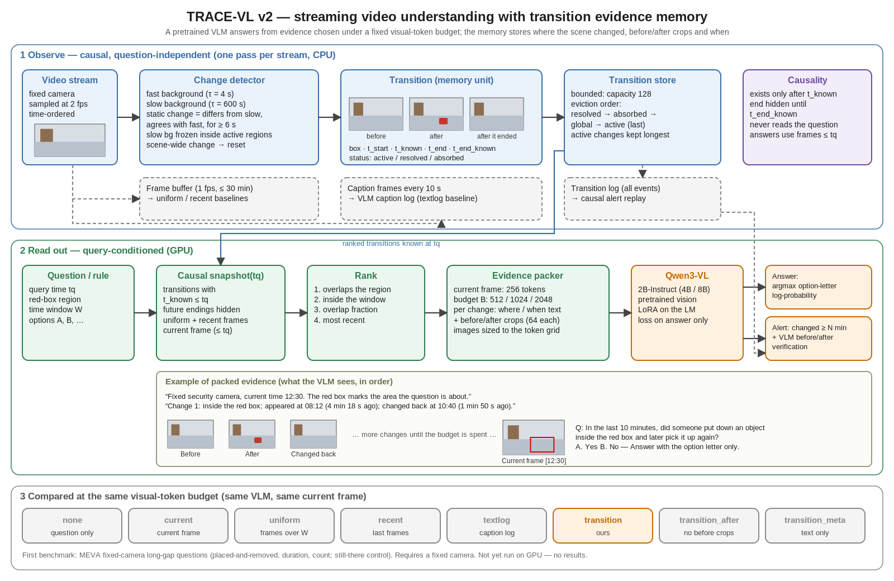

# TRACE-VL

TRACE-VL 是一个**流式视频理解模型**：视频按时间顺序到达，模型维护有界的“转移证据记忆”，在任意时刻回答关于当前与过去的问题，并支持基于规则的告警。核心假设是：以“场景转移”（哪里变了、变化前后的样子、何时出现、何时恢复）作为记忆单位，在相同视觉 token 预算下，比均匀抽帧、最近帧窗口或文字字幕日志更能回答长间隔的历史问题（发生过什么又恢复了、持续了多久、发生了几次）。

第一个应用与评测场景是**固定摄像头物业巡检**：变化的位置与时间最明确，且有公开标注数据（MEVA）可以构造长间隔问题和“物品遗留超过 N 分钟”一类的时长告警。巡检是检验模型的场景，不是模型的全部目标。

> 状态（2026-11-06）：当前版本（v2）代码与 MEVA 基准已实现，**尚未在 GPU 和真实视频上运行**，目前没有任何结果。下文所有判断标准都是待检验的假设。

当前限制：转移检测基于像素级双背景差分，**要求摄像头固定**。移动摄像头视频（第一人称、影视、网络视频）需要特征级或 VLM 嵌入级的变化检测，尚未实现；Video-MME、OVO、StreamingBench 等通用视频 benchmark 的 v2 适配器也尚未实现。

最初的 v1 潜变量模型（冻结 Qwen3-1.7B + SigLIP2 + 随机初始化时空桥接，约 2.105B）保留为 [旧版 TRACE-VL](#旧版-trace-vlv1-潜变量流式模型)。它在本地试验中没有学会使用视频（视频错配后 EM 不变），这是转向 v2 的原因。

## 模型（v2：预训练 VLM + 转移证据记忆）



可编辑矢量图：[architecture_v2.svg](assets/architecture_v2.svg)，由 `python scripts/draw_architecture_v2.py` 生成。

```text
视频 (2 fps) ─> 双背景变化检测器 ─> 区域级转移（变化前裁剪、变化后裁剪、t_start / t_known / t_end）
             ─> 有界转移存储（已恢复的先淘汰，仍存在的最后淘汰）
问题或规则 ─> 按区域、时间窗、时近排序 ─> 在视觉 token 预算内打包证据
          ─> Qwen3-VL（当前帧 + 证据） ─> 选项字母对数概率 / 告警确认
```

- 预训练 VLM（默认 Qwen3-VL-2B-Instruct，可选 4B/8B）直接看图，视觉对齐来自预训练而不是从零学习；可用 LoRA 只训练答案字母。
- 变化检测是因果的：转移在确认时刻 `t_known` 之后才可见，恢复在 `t_end_known` 之前对模型隐藏。
- 所有方法共享同一张当前帧（`frame_tokens`）和同样的额外预算（`budget_tokens`）；图片按 VLM token 网格缩放，计划 token 数与实际一致，评测同时记录处理器实际产生的 token 数。

| 方法 | 证据 | 作用 |
|---|---|---|
| `none` | 只有问题文字 | 语言先验对照，应接近随机 |
| `current` | 当前帧 | 无记忆对照 |
| `uniform` | 时间窗内均匀抽帧 | 离线长视频基线 |
| `recent` | 最近若干帧 | 滑动窗口流式基线 |
| `textlog` | 同一 VLM 每 10 秒写的字幕日志 | 文字记忆基线（字幕计算单独报告） |
| `transition` | 转移记忆：前后裁剪 + 时间 | **本方法** |
| `transition_after` / `transition_meta` | 去掉变化前裁剪 / 只有时间和位置文字 | 消融：检验“变化前后”结构本身 |

完整模型说明、因果保证、预算和未验证项见 [模型文档](docs/architecture.md)；巡检基准构建、标注审计与运行步骤见 [inspection.md](docs/inspection.md)。代码位于 `src/trace_vl/inspection/`（以首个应用命名），命令为 `trace-vl inspection ...`。

## 首个评测场景：固定摄像头巡检（MEVA 长间隔问题，仅公开数据）

[MEVA](https://mevadata.org)（CC BY 4.0）提供学校、行政楼、公交站、医院、停车场等固定摄像头视频与活动标注。同一摄像头连续的 5 分钟片段被拼接成最长约 1 小时的流；“放下物品”与之后同一位置的“拿起物品”按空间位置关联。

| 题型 | 需要记忆 | 示例 |
|---|---|---|
| `placed_and_removed` | 是 | 最近 10 分钟内，是否有人在红框内放下物品又拿走？ |
| `duration` | 是 | 红框内的物品已放置多久？（<1 / 1–5 / 5–15 / >15 分钟） |
| `count` | 是 | 最近 5 分钟内，有人在红框内放下物品几次？ |
| `still_there` | 否（对照） | 之前有人在红框内放下物品，现在还在吗？ |

按摄像头划分 train/val/test（70/10/20），每类答案平衡，负例包括同一区域事件发生前和“放下后仍在”。关联是启发式的：未关联到拿起的物品标记为 `censored`，结果须同时报告 `--exclude-censored`，并附 `audit.csv` 人工核对的标签准确率。门的开关状态不使用（MEVA 几乎没有标注关门）。

## 运行（本机 2×RTX 5090）

阿里云服务器可使用 `bash scripts/setup_aliyun.sh` 安装 Linux x86_64 / Python 3.10 训练环境：
普通包和 CUDA 12.8 wheel 均走阿里云镜像，完整保留基准锁中的版本、条件标记和哈希，根锁文件保持原样。
操作、验证和已有锁文件改动的处理见 [阿里云环境说明](docs/aliyun_environment.md)。

Python 3.10，uv 锁定依赖，PyTorch 2.8.0 / CUDA 12.8；`vlm` 依赖组包含 transformers、peft 与 torchvision（cu128）。`evaluate` 在输出目录写入 `run.json` 指纹（模型、adapter 权重哈希、打包设置、问题与快照报告哈希），模型或数据不同时拒绝续写，需换新的 `--output`；`score` 的置信区间按摄像头整体重采样。

```bash
uv sync --extra dev --extra vlm
uv run --locked pytest -q tests/test_inspection.py

uv run --locked trace-vl inspection meva-fetch                    # 只下载标注
uv run --locked trace-vl inspection meva-build                    # 生成流、问题、审计表
uv run --locked trace-vl inspection meva-videos --split test --output data/meva/urls_test.txt
aria2c -i data/meva/urls_test.txt -d data/raw/meva -j 8 -c          # 约 140 MB / 5 分钟片段
uv run --locked trace-vl inspection prepare --split test --workers 8

CUDA_VISIBLE_DEVICES=0 uv run --locked trace-vl inspection evaluate --shard 0/2 &
CUDA_VISIBLE_DEVICES=1 uv run --locked trace-vl inspection evaluate --shard 1/2 &
wait
uv run --locked trace-vl inspection score --output outputs/inspection/eval/score.json
uv run --locked trace-vl inspection alerts --min-duration 120

# LoRA 微调（先 prepare --split train），双卡
CUDA_VISIBLE_DEVICES=0,1 uv run --locked torchrun --standalone --nproc_per_node=2 -m trace_vl \
  inspection train --method transition --budget 1024 --output outputs/inspection/lora-transition
```

字幕基线 `textlog` 需先运行 `inspection caption`，完整步骤见 [inspection.md](docs/inspection.md)。配置：`configs/inspection/qwen3vl_2b.yaml`（单卡 5090）、`qwen3vl_4b.yaml`、`qwen3vl_8b.yaml`（4×A100 规模检查）。

**什么结果才支持假设**：在相同平均视觉 token 下，`transition` 在三类记忆题上的宏平均平衡准确率高于 `uniform`、`recent`、`textlog`，按摄像头 bootstrap 的置信区间不重叠，且间隔越长差距越大；`still_there` 上与 `current` 相当；`none` 接近随机；`transition` > `transition_after` > `transition_meta`；排除 censored 后结论不变。

## 旧版 TRACE-VL（v1 潜变量流式模型）

约 2.105B：冻结 SigLIP2 与 Qwen3-1.7B，训练约 6800 万新增参数（因果时空 Transformer、门控工作状态、四段式转移胶囊、证据重采样器、告警头）。架构见 [模型文档的 v1 部分](docs/architecture.md#v1潜变量流式模型旧版)，[原始设计提案](docs/design_proposal_v0.1.md) 与 [架构示意图](assets/architecture.png)（AI 生成的写实示意，[可编辑 draw.io](assets/architecture.drawio)）保留用于对照。

本地试验（ActivityNet/LLaVA-Video 短视频，180 训练 / 20 验证视频）：

| 试验 | 验证 EM | 视频错配后 EM | 报告 |
|---|---:|---:|---|
| 单卡 4 帧，1 轮（450 步） | 28.5% | 28.5%¹ | [activitynetqa_baseline](docs/experiments/activitynetqa_baseline_2026-11-05.md) |
| 双卡续训至 2250 步 | 30.5% | 30.5% | [ddp_extension](docs/experiments/ddp_extension_2026-11-05.md) |
| 32 帧 / 224 token 高显存调参 | 29.5% / 29.0% | 29.0% / 29.0% | [high_memory_tuning](docs/experiments/high_memory_tuning_2026-11-05.md) |

¹ 来自延长训练报告中 450 步 checkpoint 的配对对照（同次评测正确视频 EM 为 28.0%）。EM 为本地归一化词面匹配，非官方 judge。

结论：答案几乎完全来自语言先验，模型没有建立视觉依赖。旧版代码、配置和命令保持可用：

```bash
uv sync --extra dev --extra hf
env -u PYTHONPATH uv run --locked pytest -q
CUDA_VISIBLE_DEVICES=0 uv run --locked trace-vl train --config configs/hardware/2x5090_smoke.yaml --output outputs/gpu-smoke
CUDA_VISIBLE_DEVICES=0,1 uv run --locked torchrun --standalone --nproc_per_node=2 -m trace_vl train \
  --config configs/local_2b_ddp_5epochs.yaml --output outputs/ddp
```

数据准备与其他 benchmark 接入见 [本机训练步骤](docs/local_training_pilot.md)、[数据规范](docs/data.md)、[评测协议](benchmarks/README.md)、[实验计划](docs/research_plan.md)、[硬件预算](docs/resources.md)、[数据集下载清单](docs/dataset_download_plan.md)、[验证记录](docs/validation.md)。启动脚本会在进程内清除外部 `PYTHONPATH`；直接运行 pytest 时使用 `env -u PYTHONPATH`。

## 仓库内容

```text
src/trace_vl/inspection/  v2 模型：变化检测、转移存储、证据打包、VLM、MEVA 基准、评测、训练、告警
src/trace_vl/             v1 潜变量模型、数据读取、训练、推理、指标与 CLI（trace-vl）
configs/inspection/       v2 配置（2B / 4B / 8B）
configs/                  v1 tiny、约 2B、5090/A100 与消融配置
tests/                    test_inspection.py（v2，CPU，无需权重）与 v1 测试
docs/                     模型文档、基准与运行说明、实验报告、数据与资源说明
benchmarks/ scripts/      v1 评测协议与脚本
```

视频与上游授权数据不随仓库分发。代码采用 MIT；预训练权重和第三方数据遵守各自协议（MEVA 为 CC BY 4.0）。
