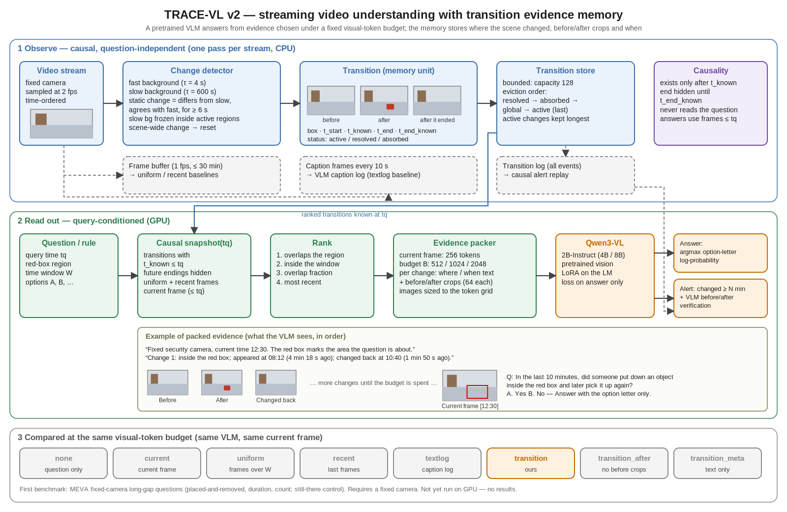

# TRACE-VL 模型文档

TRACE-VL 是流式视频理解模型：视频按时间到达，模型维护有界的转移证据记忆，在任意时刻回答关于当前与过去的问题，并支持规则告警。本文先描述当前 v2（预训练 VLM + 转移证据记忆），再保留 v1 潜变量模型的实现对应表。v2 尚未在 GPU 和真实视频上运行，下文没有任何结果。

## v2：预训练 VLM + 转移证据记忆

### 设计动机

v1 用随机初始化的时空桥接把视觉特征压成冻结 LLM 的前缀，1800 条 QA 不足以完成对齐，视频错配后 EM 不变。v2 不再重新学习视觉对齐：预训练 VLM 直接看图，研究变量变成“在固定视觉 token 预算下给它看什么证据”。转移记忆是这一选择的核心。

### 数据流



```text
视频帧 (sample_fps=2)
  └─ ChangeDetector（双背景差分，因果）
       └─ Transition {box, before, after, after_end, t_start, t_known, t_end, t_end_known, status}
            └─ TransitionStore（容量 capacity，带淘汰策略）
问题 / 规则 + 查询时刻 tq + 区域 region + 时间窗 window
  └─ 因果快照：snapshot(tq) 只含 t_known ≤ tq 的转移，未确认的恢复被隐藏
       └─ 排序：与区域重叠 > 落在时间窗内 > 重叠比例 > 时近
            └─ Packer：当前帧 frame_tokens + 证据 budget_tokens
                 └─ VLM（Qwen3-VL）：选项字母对数概率 / 生成 / 告警确认
```

### 组件

| 组件 | 文件 | 说明 |
|---|---|---|
| 变化检测 | `inspection/change.py` | 快背景（`short_seconds`）跟随静止下来的内容，慢背景（`long_seconds`）保留原场景。像素“与慢背景不同但与快背景一致”且当前仍与慢背景不同，持续 `confirm_seconds` 后确认为转移。活动区域内冻结慢背景，长时间遗留不会被悄悄吸收；超过 `absorb_seconds` 才显式吸收并标记 `absorbed`。区域与慢背景重新一致并持续 `vanish_seconds` 后判定恢复。起始时间取像素与慢背景连续不同的起点（人或物到达时），而不是确认时刻。全画面大面积变化（开关灯）重置背景，不写入大量伪转移。 |
| 转移存储 | `inspection/memory.py` | 固定容量；淘汰顺序为已恢复（按恢复时间）→ 已吸收 → 全局变化 → 仍存在（最旧）。被淘汰的转移不会因后续事件复活。 |
| 证据打包 | `inspection/evidence.py` | 所有方法共享当前帧 `frame_tokens` 与额外预算 `budget_tokens`。图片缩放为 `unit`（Qwen3-VL 为 32 px）的整数倍，计划 token 数即实际 token 数。转移以文字（位置、出现/恢复时刻与距今时长）加前后裁剪（每张 `crop_tokens`）呈现，按排序依次放入直到预算用完。 |
| VLM | `inspection/vlm.py` | 默认 Qwen3-VL-2B-Instruct（4B/8B 可选）。选择题以选项字母的下一 token 对数概率作答，单次前向、无需解析输出；字幕用贪心生成；训练为 LoRA（只作用于语言模型的注意力与 MLP 投影），损失只计算助手答案。 |
| 流处理 | `inspection/stream.py` | 每条流只解码一次：运行检测器，按 `buffer_fps` 缓存降采样帧，每 `caption_every` 秒保存字幕帧，并在每个查询时刻写快照（当前帧、时间窗内均匀帧、最近帧、已知转移）。查询使用不晚于 `tq` 的最后一帧。 |
| 告警 | `inspection/alerts.py` | 时长规则“区域变化持续 ≥ N 分钟”从转移日志因果回放，告警时刻为 `max(t_start + N, t_known)`；可选 VLM 前后裁剪确认以过滤人员静止等误报。 |

### 因果保证

- 转移在 `t_known` 之前不存在；恢复与吸收在 `t_end_known` 之前对快照隐藏，状态显示为“仍存在”。
- 查询只使用时间不晚于 `tq` 的帧；字幕日志只包含 `t ≤ tq` 的字幕。
- 检测与记忆不读取问题；问题只影响读取时的排序与打包。

### 对比方法与消融（相同预算）

`none`（只有问题）、`current`（当前帧）、`uniform`（时间窗均匀帧）、`recent`（最近帧）、`textlog`（同一 VLM 写的字幕日志）、`transition`（本方法）、`transition_after`（去掉变化前裁剪）、`transition_meta`（只有时间与位置文字）。`uniform`/`recent` 把 `budget_tokens` 均分给 `frames` 张图；`transition` 每条转移消耗 2–3 个 `crop_tokens`。`textlog` 的文字不占视觉 token，但字幕需要额外 VLM 计算，单独报告。

### 资源预算（估算，待实测）

| 项 | 默认值 | 说明 |
|---|---|---|
| 每题视觉 token | 256 + 512/1024/2048 | 当前帧 + 证据预算 |
| VLM 权重 | 2B bf16 约 4–5 GB | 单张 5090 可评测与 LoRA 微调；4B 需梯度检查点；8B 建议 A100 |
| 检测器 | CPU，工作分辨率宽 480 | 每路流单进程，`--workers` 并行 |
| 转移裁剪 | 最长边 320 px JPEG | 每条流写一次，快照只引用路径 |

### 首个评测场景与当前限制

首个场景是固定摄像头物业巡检，基准由公开 MEVA 标注构建（题型、审计与运行步骤见 [inspection.md](inspection.md)）。

| 限制 | 影响 | 后续方向 |
|---|---|---|
| 像素级双背景差分要求摄像头固定 | 移动摄像头、剪辑视频无法使用转移记忆 | 在 VLM 视觉嵌入或特征空间做变化检测，并做相机运动补偿 |
| 通用视频 benchmark 未接入 v2 | 尚不能与 Video-MME、OVO、StreamingBench 上的模型比较 | 为通用视频实现嵌入级转移与适配器 |
| MEVA 持久性标签为启发式关联 | 标签噪声，需要人工审计 | 报告审计准确率与 `--exclude-censored` 结果；补充合成精确标签数据 |
| 转移只覆盖“静止下来的变化” | 只经过、未停留的动作（如路过）不进入记忆 | 增加运动事件摘要或与均匀帧组合 |
| 告警精确率只有下界 | 未标注的变化计为误报 | VLM 确认与人工抽检 |

## v1：潜变量流式模型（旧版）

v1 的代码、配置与实验保留可用，结论见 README 中的旧版试验表。以下为原实现对应表。

TRACE-VL 研究的是：在固定视频状态预算下，用包含变化前后信息的证据胶囊，兼顾流式告警和较晚出现的问题。约 2B 是复用骨干后的总参数规模目标；`inspect` 输出才是本实现实例化后的实际参数量。

```text
RGB frame -> vision tower -> spatial coverage + saliency selection -> RGB bridge
RGB difference -> motion CNN -------------------------------> merge tokens
    -> [same-frame spatial attention -> causal temporal attention -> FFN] x L
    -> gated working state + transition capsules -> bounded event bank
rule embedding + working state + event summary -> alert head at each observation
question embedding -> retrieve past capsules -> evidence resampler -> LLM prefix -> answer
```

### 已实现

- 帧内空间 attention、过去帧的 projected K/V cache 和跨帧时间窗口。位置偏置输入真实 patch 坐标差及 `log1p(时间差)`。新状态只能使用当前帧、过去缓存和上一步状态。
- RGB patch 覆盖采样与特征离差排序；先运行完整 ViT 再选 token，因此没有减少 ViT 自身计算。
- 门控工作状态；每个事件 4 个潜在 token，分别读取之前状态、变化上下文、之后状态和当前视觉细节。`before_valid` 标记是否存在之前观测；它不是对象轨迹或文字事件标注。
- 可选 `normalize_memory: true` 在门控工作状态和新胶囊上应用无参数 LayerNorm，抑制长展开时状态放大；默认 false 保持旧 checkpoint 行为。高显存调参开启此开关，参数量不变。
- FIFO 或预测 utility 的优先保留；固定容量；默认每帧写入是可复现基线。learned-write 有二值 gate、训练时 straight-through surrogate 和写入辅助损失。priority 的离散替换本身不可微，utility head 需真实 `utility_targets` 监督。
- 规则条件告警。未来问答不参加观测与写入。问题仅在读出阶段选择历史事件，附带 `observed_start`、`known_at` 和 before-valid 的时间编码，然后转换为语言模型视觉前缀。
- 文本、告警、写入和可选 utility 损失；TBPTT detach；冻结骨干和可选 LoRA；单机 DDP。

### 尚未实现或未验证

| 设计概念 | 当前边界 |
|---|---|
| codec-native residual / motion vectors | 当前输入是 RGB 差分，尚无码流残差提取与编码器 |
| scout 与自适应采样 | 当前是预先定义截止时刻的采样回放，未实现实时 RTSP 调度 |
| 对象交互、身份关联 | 当前为空间/时空 attention，没有检测、跟踪或专门图网络 |
| 事件语义解释 | capsule 是潜在表征，不能保证每个 token 已学会所命名的语义 |
| 长期因果证据 | 有界状态无法无损保留无限事件；检索到的是压缩状态，必须评估遗忘 |
| utility 蒸馏、反事实训练 | 有监督接口，没有教师生成、对比配对和完整训练配方 |
| 真实 2B 效果与显存 | 已完成缓存骨干上的四帧真实训练与本地验证；更长输入、监控能力和论文 benchmark 仍待验证，见本机实验报告 |
| 论文创新性 | 当前是研究假设，须与 streaming-memory / codec-VLM 最近工作对比并完成消融 |

### 预算与消融

参考尺寸 `d=768, L=4, N=96 RGB+16 motion, K=8 frames, S=32 state slots, C=128 capsules×4 tokens`。BF16 主状态中：事件潜变量约 0.75 MiB；单层 K/V 约 2.625 MiB，4 层约 10.5 MiB；这不含 working state、元数据、张量临时缓冲、反向图、骨干、优化器和显存分配器。训练不是这些推理状态字节数的简单倍数。

新模块及根级 token_types 参数合计 **67,817,011**，明细见 [implementation_budget.json](implementation_budget.json)。修正了旧统计只累加子模块、漏计 token_types 的 1,536 个参数的问题，没有改变模型结构。本机真实加载缓存 HF 权重后，总参数为 **2,104,675,891**：视觉骨干 316,283,904，语言骨干 1,720,574,976，新增参数 67,817,011。HFVision 包含 pooling head；早期提案中的 2.084B 是设计估算，不是当前实测值。真实数据试验见 [实验报告](experiments/activitynetqa_baseline_2026-11-05.md)。

消融提供去除新增 ST blocks、recent-only、summary 与 capsule 等配置。`recent_only` 仍保留短期时序 K/V，移除跨窗口工作状态传递与事件写入；它不是单帧模型。`summary_equal_slots` 控制事件条目数；`summary_equal_tokens` 控制潜在 token 数与读取 token 数，元数据、attention 开销和参数量不完全一致。正式论文须同时报告参数、显存、读取 token、每秒计算时间，而不是只比较槽位数量。

主张的核心可检验问题：胶囊是否在相同资源预算下提高变化证据问答和低误报告警，尤其是在长间隔后仍能区分“曾出现”与“状态已经改变”。不能仅凭多加一个时空 Transformer 声称创新。

TBPTT 会截断跨 chunk 的梯度，后出现的 QA 不能直接监督已经 detach 的旧胶囊写入。正式长视频训练需要中间问题/告警监督、随机截止采样或专门的分段训练策略；不能把支持长期前向状态保留等同于已经解决长期信用分配。
