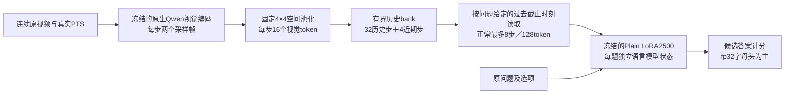

# TRACE-VL 近期研发与实验结论（2026-11-25）

本次整理覆盖原生流式视觉编码、CausalPatchPool/静态池化训练，以及自然长流中的持久存储、writer 和读出诊断。代码与结果提交到 `research/streaming-vision-a100`，基于 `design/v3-transition-streaming` 审查。

**已经建立可审计的长流实验链路，并在既用开发视频上看到保留旧视觉值的收益；尚未得到可以晋升的核心新方法。** CausalPatchPool 的小幅收益、两种启发式 writer、同预算均匀读出和更宽 bank 读取，都不足以支持当前方案扩训或论文方法优越性结论。

## 当前架构与第一版的区别

当前有效的持久记忆实验使用下面的路径。这里画的是实验实现，最终可学习架构尚未锁定。



| 组件 | 已实现与实验用途 | 当前取舍 |
|---|---|---|
| 局部视觉刷新＋全局校正 | 原生全量、直接复用、校正的五组比较 | 校正没有改善等预算QA，结束该版假设；保留全量基线 |
| CausalPatchPool | 上一时间块条件化当前空间区域权重，和LM LoRA联合训练 | 不是持久旧值存储；未晋升 |
| StaticPatchPool | 从相同初始化独立训练，历史条件始终关闭 | 分离静态空间学习与历史条件贡献 |
| 持久bank | 连续流只编码一次，保存旧视觉值；FIFO/Reservoir/Prefix等对照 | Reservoir保留为强基线 |
| 新writer | 时间覆盖与空间变化；容量、读出和模型固定 | 没有证明优于三个Reservoir记忆种子的均值 |
| bank读出 | latest8、uniform8、all_bank | uniform8无稳定收益；增加读取量也未稳定改善 |

相比最早的短片段压缩，新增的是**跨自然视频延续的显式旧值存储、因果时间读取和可重放审计**。持久bank与CausalPatchPool是不同机制，不能把前者的结果归给后者。当前77视频实验使用Plain检查点，没有把未通过晋升的池化器叠加进去。

## 近期实验全貌

| 实验 | 固定队列与预算 | 结果 | 决定 |
|---|---|---|---|
| 原生视觉刷新/校正 | OVO开发674题、StreamingBench实时视觉子集250题 | 校正相对直接复用QA持平或下降，视觉P95未胜过全量 | 结束这版全局校正假设 |
| CausalPatchPool＋独立静态对照 | 39,997训练题、seed17、各2500更新、16帧/128视觉token；OVO674与NExT-QA1744题 | NExT时序主指标有小幅收益，OVO回溯未稳定改善，未达到原联合+2pp门槛 | 不晋升、不据此扩训 |
| 过去事件自然延迟 | 34目标/28源、5种延迟；主层26目标/23源 | 300秒Reservoir与纯文本均19/26；特权快照21/26 | 保留失败，不能混入预测题改善结论 |
| 状态问题自然延迟 | 新的77目标/77既用开发源、5种延迟、385查询/2310预测 | 原种子Reservoir在300秒57/77，纯文本42/77 | 支持该开发设置下旧视觉值的用途 |
| 容量匹配writer | 同77源/385查询，10臂/3850预测 | 两个新writer点估计均低于三个Reservoir运行 | 不晋升新writer |
| 已存bank离线读出 | 同77源的300秒题，三个记忆种子，11臂/847预测 | uniform8 +2.16pp、all_bank −0.43pp，区间均跨0 | 不晋升读出策略 |

前两种自然延迟队列回答不同问题。77源状态题从已使用的250源开发边界中，按预先固定的任务标签、时间和原视频可延续长度选出，39道Action、38道Object；不是删掉26道过去事件题中的失败。二者均完整保留，不能将状态题的正向结果直接推广为已解决历史事件理解。

### CausalPatchPool与静态对照

以下统一使用独立静态对照完整复核中的源视频cluster-bootstrap区间，4000次、seed7。它重用了原Plain和Causal两组的最终权重/预测，只新训练Static组；不是三个新训练种子。早期两组报告采用不同重采样遍历顺序，其端点略有差异，保留原报告，不混用区间。

| 主指标 | Causal−Plain | 95%区间 | Causal−Static | 95%区间 |
|---|---:|---:|---:|---:|
| OVO回溯291题 | +0.344pp | [−0.714,+1.613] | −0.344pp | [−1.481,+0.769] |
| NExT时序555题 | +0.721pp | [+0.173,+1.482] | +0.901pp | [+0.183,+1.748] |

NExT的小幅正向证据需要保留，但它未达到原定联合门槛，也不是长流记忆证据。`history_off`是同一检查点的推理干预，独立训练的Static组是另外一种控制。Static保留的9216个predictor参数不活跃且审计未变，不能当作有效容量或等部署成本。

协议：[机制消融](pool_probe.md)、[独立静态对照](static_pool.md)。数据：[池化分析](results/20261125/causal_pool_analysis.json)、[静态对照独立复核](results/20261125/static_pool_review.json)。

### 77源状态问题：旧视觉值确实有用

每个源固定一题，每题在原时刻及自然延续15/60/180/300秒后作答。普通bank为32历史＋4近期步，读出至多128视觉token。只有到达时最近画面控制可以看目标后的当前帧；历史方法只读不晚于原目标时刻的帧。问题明确原截止时刻，金标不随延迟改变。

| 对照（正确数/77） | 0秒 | 15秒 | 60秒 | 180秒 | 300秒 |
|---|---:|---:|---:|---:|---:|
| 纯文本 | 42 | 42 | 42 | 42 | 42 |
| 到达时最近8步 | 64 | 56 | 49 | 49 | 43 |
| FIFO时间读取 | 64 | 64 | 42 | 42 | 42 |
| 原种子Reservoir | 63 | 55 | 55 | 54 | 57 |
| Prefix时间读取 | 65 | 40 | 40 | 40 | 40 |
| 特权目标时刻快照 | 64 | 64 | 64 | 64 | 64 |

特权快照−纯文本为+28.57pp，探索性95%区间[+15.58,+41.56]；次要比较Reservoir300秒−纯文本为+19.48pp，[+6.49,+32.47]。原种子300秒−0秒为−7.79pp，[−18.18,+2.60]；300秒−快照为−9.09pp，[−19.48,+1.30]，均不能证明退化或唯一writer瓶颈。FIFO在60秒后77/77题没有目标前可读帧，其42/77来自文本回退。

特权快照知道未来目标时刻，跨延迟固定输入是控制设计；它不是可部署writer或完美语义oracle。旧问题需要的时间地址在派生题中显式给出，公开协议若不提供该地址，适配器不能偷偷使用标注证据时间。

详细报告：[77源状态实验](longstream_states_result_20261125.md)。机器数据：[独立复核](results/20261125/longstream_states_review.json)、[汇总](results/20261125/summary.json)。

### 新writer：没有通过强基线比较

保持同一模型、数据、32/4/128预算和读取器，增加时间覆盖、空间变化writer与两个预先指定的Reservoir随机流。三个记忆种子共用同一个冻结训练检查点。

| 300秒策略 | 正确数/77 | 准确率 | 相对三个Reservoir均值 | 95%区间 |
|---|---:|---:|---:|---:|
| Reservoir三个种子 | 57 / 53 / 53 | 70.56%（均值） | — | — |
| 时间覆盖 | 52 | 67.53% | −3.03pp | [−9.96,+3.90] |
| 空间变化 | 50 | 64.94% | −5.63pp | [−12.56,+1.30] |

两个区间跨0，结论是未证明优越，不能声称已统计确认更差。空间变化还增加了写入工作。每步append均值0.601ms（时间覆盖）、4.543ms（空间变化），包含同步与检查，并非隔离单策略端到端时延。每个新增bank的逻辑特征及槽元数据上界为2,952,576字节，不是进程RSS或全系统显存。

详细报告：[writer结果](writer_controls_result_20261125.md)、[独立复核](results/20261125/writer_controls_review.json)。

### 已存bank读出：完整847项结果

重建的是各个种子原运行真正存下的目标前帧；RGB必须与旧记录哈希相同。共享离线编码缓存只节省重建工作，正常选择器不能访问其他种子或特权快照。原问题、选项和权重不变。

| 读出 | 原种子正确/77 | 标签29 | 标签43 | 平均准确率 | 相对latest8 | 95%区间 |
|---|---:|---:|---:|---:|---:|---:|
| latest8 | 57 | 53 | 53 | 70.56% | — | — |
| uniform8 | 55 | 58 | 55 | 72.73% | +2.16pp | [−1.73,+6.06] |
| all_bank | 54 | 55 | 53 | 70.13% | −0.43pp | [−3.90,+3.03] |

latest8和uniform8逐视频逐种子实际token数相同，上限128。all_bank预设上限512，实际最多400、均值196.71视觉token，是额外读取预算的离线诊断。两个区间均跨0，不能证明优越或等价。更宽读取没有稳定补回性能，也没有排除更强检索、更好的表示或事件连续性方法。

全部385项原始对照预测精确复现，含候选logit和帧身份；3190对RGB核验、3190次离线编码、额外5次native parity最大logit差均为0。`query_time_encoder_calls=0`只表示答题函数在重建后不再编码，不等于真实在线流程无重编码成本。主计分为bf16隐藏态上的fp32字母头，12项选择与bf16头不同。

详细协议及结果：[离线bank读出](../offline-bank-readout.md)。机器数据：[独立复核](results/20261125/bank_readout_review.json)、[77源完整配对正确性与token数](results/20261125/bank_readout_paired_sources.json)。

## 可信范围与可复查材料

所有新结果都来自既用开发来源、单个训练模型；来源可能共享创作者或内容。这里的bootstrap区间是探索性pointwise区间，未做多重比较校正。writer与读出比较先在源内平均三个记忆种子，再以77源重采样，不能把231个种子视频当成独立样本。

实验冻结代码、模型与adapter身份、输入清单、媒体SHA256、完整PTS和实际RGB引用；每题使用独立LM状态。writer运行的2310项旧预测、读出运行的385项旧预测分别精确重放。writer的72,512条状态事件被独立重放，但空间成本特征来源没有通过第二次视觉编码重新认证。bank读出对被重建RGB另做了实际解码哈希检查。不同复核深度分别记录。

仓库保存轻量统计、复核记录和哈希清单：[results/20261125](results/20261125/)。完整媒体、权重、原始预测和归档保留在实验存储，不装入Git。复核JSON是已完成的核验记录，不能单独替代原始视频和检查点来重新推理。

| 运行 | 提交 | 完整输出目录（A100） |
|---|---|---|
| Plain/Causal训练 | `2efc7cc` | `/data/yyy/tracevl-runs/core-pool-2efc7cc-001` |
| 独立Static训练 | `bfcc67d` | `/data/yyy/tracevl-runs/core-static-pool-bfcc67d-001` |
| 34目标过去事件 | `298b8b0` | `/data/yyy/tracevl-runs/core-longstream-candidates-298b8b0-001` |
| 77源状态基线 | `3dc8c83` | `/data/yyy/tracevl-runs/core-longstream-states-3dc8c83-001` |
| 新writer对照 | `60bd0df` | `/data/yyy/tracevl-runs/core-writer-controls-60bd0df-001` |
| bank读出 | `27c35b0` | `/data/yyy/tracevl-runs/core-bank-readout-27c35b0-002` |

bank读出的001目录因部署包装脚本语法错误在GPU启动前停止，保留原目录；修复并编译包装脚本后在002运行同一已测试研究提交。其他失败及修复见各实验协议、提交与原运行日志，没有用改小队列掩盖失败。

## 下一阶段：设计、训练、公开评测

1. 保留Reservoir、原生全量与固定池化作为基线。下一模块围绕短事件连续性和问题条件检索明确假设、输入、状态、监督和失败条件，尚未宣称该模块已完成或已有收益。
2. 模块实现后先验证真实历史依赖、因果性和容量，再开展相应长流训练。旧16帧任务多训练几天不等于长流训练；训练量按实测吞吐和收敛决定，不预先承诺固定天数。
3. 开发阶段选定架构、训练配方与检查点后，冻结最终权重、超参数和评测配置，接入OVO-Bench、StreamingBench官方协议，Video-MME Long作补充。记录真实帧数、模态、时间戳、提示、状态与计算预算，隔离已用开发来源和仍未使用的来源。

当前77源派生延迟题与过去事件队列均不是公开benchmark正式成绩。没有新方法优越性证据时，不以启发式换名、局部涨点或特权控制包装创新。

## 审查顺序与复现入口

建议先看本页与[机器汇总](results/20261125/summary.json)，再看`temporal.py`/训练对照，随后看`longstream.py`的存储读取、writer策略与最后的`bank_readout.py`。更早的刷新和独立历史读取实验保留在[流式视觉实验](streaming_vision.md)，不是新的默认最终架构。

CPU回归与静态检查：

```bash
PYTHONPATH=src PYTEST_DISABLE_PLUGIN_AUTOLOAD=1 OMP_NUM_THREADS=2 MKL_NUM_THREADS=2 python -m pytest -q
ruff check src tests scripts
```

A100启动器从`TRACE_REV`导出独立源码快照，检查GPU可用显存、源身份及真实模型烟测，门禁通过才进入全量；不更改服务器工作树。各协议列出必要既有媒体、权重和参考报告。以下是复现入口，不能直接当作无依赖的新机器命令：

```bash
TRACE_REV=3dc8c83 bash scripts/launch_core_longstream_states_a100.sh
TRACE_REV=60bd0df bash scripts/launch_core_writer_controls_a100.sh
TRACE_REV=27c35b0 bash scripts/launch_core_bank_readout_a100.sh
```

复现时显式设置新的`TRACE_OUT`，保留旧运行及其身份；已有输出只允许在输入和代码身份一致时恢复。测试通过表示实现与控制检查通过，不表示方法涨点。
