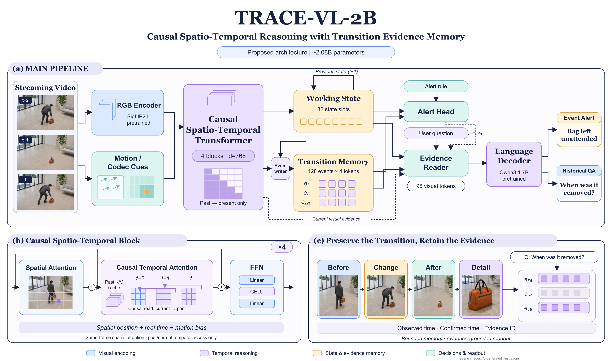
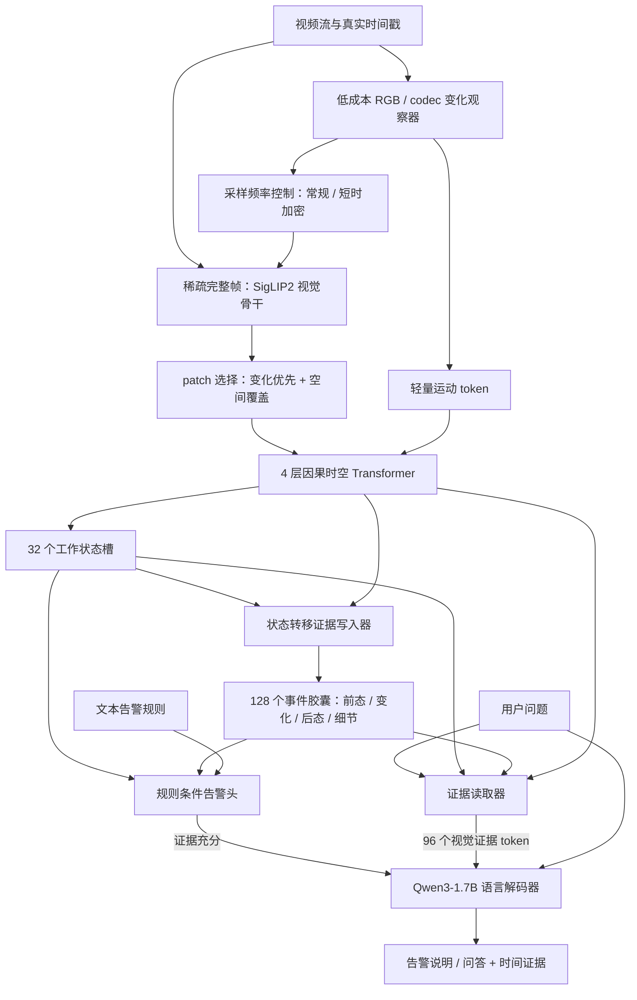

# TRACE-VL-2B：面向告警与长视频问答的因果时空模型

日期：2026-11-05。版本：v0.1，供架构评审。TRACE 为项目暂名，不表示已公开、已训练或已验证的模型。

## 1. 要研究的模型

设计一个约 **2.08B 总参数**的视频语言模型：复用预训练语言与图像骨干，增加 **4 层因果时空 Transformer**，将短时动作理解转化为可持续更新的场景状态，并把关键变化保留为具有前后状态的事件证据。

输入是单路带时间戳的视频与文本规则/问题；输出包括规则条件下的告警、证据时间区间和历史问答。第一版限定单摄像头、视觉与文本，不加入原生音频、跨摄像头身份关联、外部搜索或 MoE。

两类任务共享同一视觉状态与事件记忆：

- 持续模式：判断某条规则何时被视觉证据满足，例如物品放置后持续无人取走。
- 查询模式：回答过去发生了什么、顺序如何、某物从何时出现或何时被取走。

**主要研究假设：在有限记忆下，保留状态转移的前态、变化、后态及局部证据，比只保留帧摘要或当前状态更有利于告警和延迟问答。** 这是假设，不是已有实验结论。

## 2. 总体连接

可编辑版本：[draw.io 原生文件](../assets/architecture.drawio)。

上图为早期架构示意图，其中场景是 AI 生成的写实素材；当前实际代码边界见 [architecture.md](architecture.md)。正式投稿前按实际实现复核箭头、mask 轴和示例时间。[场景来源](../assets/scenes_provenance.json)已归档，原始生成提示词保留在原工作区 DOC/figures/scenes。

持续感知运行观察器、视觉编码、时空层和状态更新；告警头也持续运行。语言模型在告警需要解释或用户提出问题时运行。文本规则的语义表示在规则建立时编码并缓存，避免每个时刻重读规则。

## 3. 确定的参考配置

| 项目 | 默认设计 |
| --- | --- |
| 语言骨干 | Qwen3-1.7B，隐藏维度 2048、28 层；复用预训练权重 |
| 图像骨干 | SigLIP2-large-patch16-384，仅视觉 patch tower，隐藏维度 1024、24 层 |
| 内部视频维度 | 768 |
| 常规完整帧采样 | 2 fps，384×384；每帧原始 576 个 patch |
| 低成本观察频率 | 初始 8 fps、128×128；速度需实测 |
| 加密采样 | 有预算时短时提升完整帧采样至 4—8 fps；训练也覆盖该模式 |
| 每完整帧 RGB token | 96：64 个候选优先位置 + 32 个覆盖位置，去重后补足 |
| 运动 token | 每次完整帧更新最多 16 个，聚合其间观察器输出 |
| 因果时空层 | 4 个 block，宽度 768，12 heads，FFN 隐藏维度 2304 |
| 短时缓存 | 最近 8 次完整帧更新，每次最多 112 个 token，另设最大秒数边界 |
| 工作状态 | 32×768，持续更新 |
| 事件容量 | 128 个事件，每事件 4×768 latent token，另附时间/可见性元数据 |
| 查询历史预算 | 检索最多 16 个事件，即 64 个事件 token |
| LLM 视觉接口 | 读取器输出 96×768，再投影为 96×2048 |

采样频率、缓存帧数与秒数一起记录。动态采样时，“8 帧”不再恒等于“4 秒”。长时间跨度由记忆处理，不依靠持续扩大 LLM 上下文。

骨干配置依据：[Qwen3 配置](https://huggingface.co/Qwen/Qwen3-1.7B/blob/main/config.json)、[SigLIP2 配置](https://huggingface.co/google/siglip2-large-patch16-384/blob/main/config.json)。

### 3.1 选择完整帧的原因

第一版使用预训练 SigLIP2 编码完整帧，然后缩减送入时空层的 token。这保留已有视觉语义的可用性，也让时空与记忆的收益更容易归因。**这一步主要节省时空层和语言层成本，不宣称省去了完整帧的 ViT 计算。**

后续若要在 ViT 前直接丢弃 patch，需要单独验证稀疏输入分布与位置编码适配，并与 Mage/CoVisco 比较，作为独立版本。

### 3.2 运动信息与盲区

观察器接受低分辨率 RGB 差分；若 codec 提供运动向量、残差能量和参考帧信息，可作为额外输入。缺失 codec 信号时使用显式 mask，不能把 RGB 近似差分称为 codec 原始残差。

观察器决定是否值得增加完整帧观察频率，不能代替完整语义编码。小文字、缓慢变化、突然出现又消失的目标仍可能被漏掉；因此保留固定频率完整帧和空间覆盖 token，并单独评测短暂事件。对未被传感器有效采样的事件，不承诺模型能够恢复。

## 4. 因果时空 Transformer

每个 block 顺序包含空间注意力、时间注意力和 FFN，采用 pre-norm、残差连接。两个注意力子层使用独立的投影参数。

### 4.1 空间注意力

先在当前完整帧选择出的 RGB token 内建模空间关系；16 个运动 token 通过带类型嵌入的同帧融合参与当前时刻表示。位置使用原始图像网格坐标，而非筛选后的排列序号。

设当前表示为 X_t，空间更新为：

`U_t = X_t + SpatialAttention(LN(X_t), spatial_position, token_type)`

目标是表示人员、物品、区域及其相对关系，不假定每个 token 已对应一个稳定跟踪对象。

### 4.2 跨帧时间注意力

当前 token 以 U_t 为 query，读取该层最近帧的 K/V 与前一时刻工作状态 S_(t-1)。禁止读取未来帧和本次尚未提交的新状态。

`H_t = U_t + TemporalCrossAttention(LN(U_t), Cache_<t, S_(t-1))`

时间注意力 logit 增加可学习偏置：

`logit(i,j) = q_i·k_j / sqrt(d_head) + b_space(p_i,p_j) + b_time(t_i-t_j) + m_ij·b_motion(i,j)`

其中 m_ij 表示 codec 运动参考关系是否有效。motion bias 是软偏置；语义相关但运动不大的位置仍可被注意到。运动向量只在参考链和坐标变换可核验时使用，不能把相邻输入帧的向量无条件累积成任意历史帧之间的光流。

时间间隔使用真实秒数的连续编码或对数分桶，覆盖不规则采样；空间编码与时间编码单独可消融。不将新加入的时空位置方案直接替换语言模型原有 RoPE。

### 4.3 因果缓存与训练一致性

每层缓存有独立的历史 K/V。已经提交的历史表示不因后续帧而重新计算；新帧只追加其因果表示，超出帧数/时间窗口的部分从缓存移除。

训练时，按整帧粒度构造因果 mask：同帧 token 可以交互，跨帧只能读过去。在 dropout 关闭时，同一片段逐帧推理与带因果 mask 的并行计算应数值一致。动态选择、容量淘汰和事件确认也必须按时间顺序执行。

## 5. 工作状态与状态转移胶囊

### 5.1 两种记忆承担不同职责

工作状态 S_t 为 32 个 latent 槽，关注“现在已观察到什么”。用一层 cross-attention/FFN 读取当前 H_t 与旧状态，采用带门控残差更新：

`S_t = (1-g_t) * S_(t-1) + g_t * StateWriter(S_(t-1), H_t)`

这部分允许覆盖旧信息，以保持当前状态。槽并不天然等于对象身份；若需要对象连续性，必须通过关联监督或一致性约束学习，不能仅凭槽编号声称完成身份跟踪。

事件胶囊 E_j 则保留“发生了什么变化”，默认结构为四个 latent token：

1. before：变化前最后一次有效观察的状态；
2. transition：变化过程的差异与动作证据；
3. after：变化后已观察到的状态；
4. detail：局部上下文、关键细节和证据定位信息。

每个事件另带 `observed_start`、`observed_end`、`known_at`、可见性和状态标签。时间戳是显式数值元数据，不要求 latent token 精确记忆长整数。

第一版胶囊由 4 个带类型的学习查询读取前态、当前时空特征与后态，复用 StateWriter 的注意力/FFN 投影；不再另加一套大型胶囊 Transformer。这个参数共享约束已经计入第7节预算。

before/after 在第一版中是**已观察到的状态**，不是完整世界状态。遮挡或采样缺口应标为未知，不得把“未观察到”直接写成“不存在”。

### 5.2 提议、确认与修正

写入器比较 H_t、S_(t-1) 和 S_t，提议一个新事件或更新已有事件，维护 pending / confirmed / closed / contradicted 状态。例如看到物体被放下时创建 pending；之后观察到相关条件成立，再确认特定规则。

训练与评测都记录 `known_at`：只能从当时已经到达的证据确认事件，不能在看完整段后回填“模型早已知道”。修正需要更新版本/确认时间，不得改变过去已评分时刻的可见信息。

### 5.3 有限容量下怎样保留

在线保留决策不读取未来问题。第一版将两个因素分开处理：

- 内容效用：预测该事件对状态区分、告警以及一般延迟问答的价值；
- 冗余度：新旧胶囊之间的表示、时间和状态关系是否重复。

同一物体当前状态相似，不代表两次动作可以合并。已完成的 A→B 与 B→A 不能仅因最终回到 A 就被消成“无变化”。压缩合并须保留可表达的顺序与重复次数；无法可靠合并时采用容量淘汰，并报告信息损失。

128 个槽不可能无损保存无限历史。模型只承诺固定状态容量，历史保真度随事件密度与时间跨度评测。外部原始视频归档可作为应用增强，但必须与不回看原视频的模型主实验分开报告。

## 6. 两个输出路径

### 6.1 告警路径

输入工作状态、候选事件、规则表示、可见性与持续时间，预测事件类型、证据是否充分及是否触发。规则建立时由语言骨干编码一次，之后缓存文本表示。

告警头应包含“未知/证据不足”状态，不强制每步作出正常/异常二选一。可配置去抖、冷却和再次告警策略，全部计入端到端延迟。对于“持续超过若干分钟”等规则，即使画面无变化，也需要定时触发时钟更新，不能只在检测到运动时运行决策。

输出最少包含 `rule_id`、`event_id`、`observed_interval`、`known_at`、`evidence_ids` 和状态。自然语言解释在触发后由 LLM 生成；告警发生时间与文字解释完成时间分别计量。

### 6.2 问答路径

问题先经语言骨干作一次文本表示提取，计入查询成本；将其投影到 768 维后，查询最多 128 个胶囊，选择 16 个相关事件。投影可与语言接口权重绑定，避免引入大型查询编码器。

两层证据读取器使用 96 个学习查询，跨注意力读取当前视觉表示、32 个工作槽和至多 64 个历史事件 token，输出 96 个视觉证据 token，再由两层 MLP 映射到 Qwen 的 2048 维输入空间。

事件的起止与确认时间一起编码进读取输入。输出回答与证据事件 ID，由确定性程序将 ID 映射成已存时间区间；不要让 LLM 自由编造一个时间戳再当作定位正确。

每次回答使用当前状态快照，LLM KV 只保留本次受限上下文或另设会话预算，不随视频流无限增长。主要实验禁止读取查询之后的状态与原视频片段。

## 7. 参数、张量与状态预算

以下是按照公开骨干配置和本设计层定义计算的**设计估计**。尚未加载完整模型；运动编码器与小型 heads 仍为显式配额，落地后应按去重参数重新审计。

| 部分 | 参数估计 |
| --- | ---: |
| Qwen3-1.7B，计入共享词嵌入一次 | 1,720.575M |
| SigLIP2-L 视觉 patch tower，去除文本塔和最终池化头 | 303.689M |
| RGB 1024→768 bridge | 0.787M |
| 观察器与运动编码器配额 | 2.000M |
| 4 层空间/时间分解 Transformer | 33.085M |
| 工作状态写入层 | 5.907M |
| 两层证据读取器及 96 个查询 | 11.889M |
| 768→2048→2048 语言接口 | 5.771M |
| 路由、时间/类型嵌入、胶囊小型映射和 heads 配额 | 0.500M |
| **推理总参数估计** | **2,084.204M，约 2.08B** |

LoRA 在训练期间单独计数；合并到骨干之后再报告最终推理参数。教师模型不计入推理模型，但其训练成本必须单列。

| 边界张量 | 默认 shape，不含 batch |
| --- | --- |
| 完整帧视觉输出 | 576×1024 |
| 选择并投影后的 RGB | 96×768 |
| 聚合运动表示 | 16×768 |
| 当前时空层输入/输出 | 112×768 |
| 每层历史时间 K、V | 各 8×112×768 |
| 工作状态 | 32×768 |
| 事件胶囊池 | 128×4×768 |
| 被选历史事件 | 最多 16×4×768 |
| LLM 视觉输入 | 96×2048 |

BF16 下，每路四层时间 K/V 约 10.5 MiB，事件胶囊约 0.75 MiB；加工作状态与近期 hidden 缓冲，相关张量约 **12.61 MiB/路**。这不含模型权重、LLM KV、激活、解码表面、帧缓存、元数据、会话、外部归档和 allocator 开销，不能当作整路显存需求。

具体计算见 [参数与状态预算](design_budget.json)。

## 8. 训练路径

### A. 图文与短片段接口对齐

冻结两个大骨干，先训练语言接口、RGB bridge、时空层和读取器。使用图像 caption/QA 与短视频监督；图像作为单帧退化情形，先把新视觉接口映射到语言空间。

Qwen3-1.7B 本身是文本模型，**拼接 SigLIP2 后不会自动获得多模态能力**。这一阶段是真实的对齐训练成本，不能省略为“只训告警头”。若对齐成本过高，可另建复用现有小 VLM 的对照版本，但它的总参数与方法改动范围必须独立报告。

### B. 时空与状态转移学习

训练状态更新、胶囊写入与告警头；按需要加入语言骨干 LoRA。训练样本包含放置/取走、进入/离开、状态保持、重复动作、遮挡与困难负例。学习任务包括：

- 下一步或当前状态的特征预测/校正；
- before/after 顺序区分与被打乱时序负例；
- 已观察事件区间和最早可判断时间的监督；
- 基于当前因果前缀的回答与告警。

预测误差大并不自动等于危险，需区分训练目标与告警规则。相机抖动、光照和画质下降都应作为困难负例。

### C. 延迟查询与证据效用训练

先处理视频并更新记忆，之后才揭示训练问题，以避免查询提前决定写入。训练时对少量候选胶囊执行删除/替换对照，估计其对事件判断及问答损失的影响：

`utility_j ≈ L(task | memory_without_j) - L(task | full_memory)`

将效用信号蒸馏到只看当前和过去的在线保留头。该反事实效用只用于训练，不在每个推理时刻运行大规模删除实验。对多个冗余胶囊单独删除可能低估其联合价值，应加入成组删除的小规模对照。

总损失可包含 `L_answer + λa L_alert + λt L_transition + λe L_evidence + λu L_utility`。第一轮先验证 answer/alert/transition 三项，再增加效用项；各 λ 通过验证集选择，不在无实验时声称某组数字最优。

### D. 长流训练与部署校准

顺序更新状态，采用截断 BPTT，例如每 8 个小段 detach 一次；有意保留跨截断边界的延迟问题，用于测量梯度截断带来的遗忘。更长跨度可以离线蒸馏或少量长 unroll 实验补充，但需单列成本。

4×A100 上从 micro-batch 1、8 次完整帧更新、受限 LLM 文本长度起步。A100 40/80GB、分片和帧缓存实现将影响可训练长度，显存与吞吐必须实测。冻结 LLM 时，为使输入视觉 token 学到对齐，仍可能需要梯度经过冻结 LLM；冻结不等于这部分计算为零。

## 9. 创新主张与已有工作边界

| 已有方向 | 本方案继承什么 | 必须证明的新区别 |
| --- | --- | --- |
| Mage-VL：codec 稀疏编码与事件门控 | 运动/残差提供便宜的变化先验 | 第一版不主张新的 codec tokenizer；证明时空转移证据的价值 |
| SelectStream：有界选择性潜在记忆 | 在线写入/保留/读取需要预算管理 | 不能把“选择性记忆”本身当贡献；比较转移结构和训练效用 |
| ProtoKV：近端精确、远端原型摘要 | 需要测延迟查询 | 比较状态转移胶囊与原型摘要在相同容量下的保真度 |
| Event-VStream：事件边界与持久事件记忆 | 按事件组织历史 | “事件驱动”不是新贡献；需要证明前后状态联合编码与保留规则 |
| ObjectStream：对象锚点、变化与近期上下文 | 对象/变化组织已有人研究 | 必须加入同预算对象记忆对照，防止只是把已有思想换成可训练版本 |

原始来源：[Mage](https://arxiv.org/abs/2607.24904)、[SelectStream](https://arxiv.org/abs/2606.16353)、[ProtoKV](https://arxiv.org/abs/2606.26762)、[Event-VStream](https://arxiv.org/abs/2601.15655)、[ObjectStream](https://arxiv.org/abs/2607.28312)。

普通空间/时间分解注意力、门控更新、学习查询、before/after 表示和删除效用都各有已有研究基础。**本方案是架构提案，尚未证明其具体组合达到论文所需的新颖性。** 最值得争取的贡献是“在统一预算下可训练地保留状态转移证据，改善即时决策与未知延迟查询”，需由比较与消融支撑。

## 10. 最小可证伪实验

固定同一语言/视觉骨干与数据，至少比较：

1. 逐帧视觉 + 均匀池化，无时空 Transformer；
2. 加时空 Transformer，但只有近期窗口；
3. 相同记忆字节数的单向量事件摘要；
4. 前态/变化/后态/细节胶囊，但无学习保留；
5. 胶囊 + 学习保留的完整版本。

额外对照移除时间偏置、运动偏置、覆盖 token；将时序打乱；以相同数量普通 token 替换结构化胶囊。比较参数、训练量、输入观察频率、记忆字节数和推理时间，避免改动多个预算后将收益归因于架构。

在长时间无事件、低运动关键事件、来回恢复原态、相似事件重复、遮挡与镜头运动上分别报告。主要指标为事件级 F1、误报/小时、漏报率、p95 告警延迟、分证据年龄的 QA 准确率和时间定位。

若时空层无增益，检查采样和训练监督，再缩减层数；若胶囊不优于同容量普通 token，应放弃该结构主张；若效用训练只提升见过的规则，需降低对一般长视频问答的外推。暂不承诺 SOTA、实时 fps、亚秒延迟或任意长历史无损。

## 11. 下一步实现边界

先实现冻结骨干、4 层时空层、固定容量事件胶囊与简单告警头，打通逐帧因果缓存。第二步做图文/短视频对齐与顺序性验证。最后再训练复杂保留策略、加密采样与效用蒸馏。

v0.1 已给出模块接口、参数预算、因果约束和实验设计；尚未实现或训练模型。详细资源预算应在骨干与输入路径实际运行后更新。
