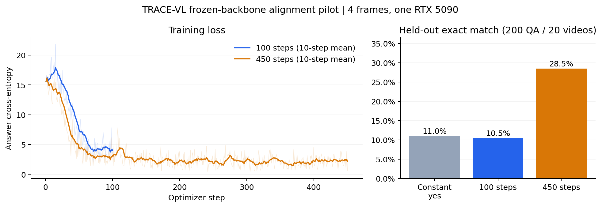

# 现有架构真实视频训练基线：2026-11-05

使用现有 TRACE-VL 架构，没有接入 JEPA。以下均为真实本机运行结果，属于短视频训练试验，不是官方 benchmark 成绩。



## 配置与数据

- Qwen3-1.7B + SigLIP2 large，实际总参数 2,104,675,891；requires_grad 参数 67,817,011。冻结视觉和语言骨干，本轮只有问答损失，告警/写入/utility 头没有对应监督。
- 单张 RTX 5090，BF16，每段最多 4 帧，384×384，每卡 batch=1，梯度累积 4，学习率 1e-4，seed=7。
- ActivityNetQA 短视频：180 个训练视频 / 1,800 QA，20 个验证视频 / 200 QA；按视频隔离。两次独立训练从同一随机种子开始，不通过恢复重放数据迭代器。
- 100 步使用 400 次训练问答呈现；450 步完整遍历 1,800 条训练问答一轮。相同种子不保证 GPU 逐位确定性。
- 原始 200 个视频中有一个 MKV 的容器估计帧数导致末帧读取失败。全部 7 个 MKV 生成 CFR H.264 副本，CRF18、源平均帧率、无音频；193 个 MP4 未变。200 个视频均完成当前采样配置的解码检查。原始媒体保留。

## 实测结果

| 试验 | 前10步均值 CE | 后10步均值 CE | 验证 EM | 验证 token F1 | 峰值 allocated / reserved GiB | 训练循环秒数 |
|---|---:|---:|---:|---:|---:|---:|
| 训练集最常见答案：yes | — | — | 11.00% | 11.00% | — | — |
| 100 步 | 16.731 | 4.085 | 10.50% | 12.92% | 6.18 / 6.92 | 66.7 |
| 450 步 | 14.657 | 2.159 | 28.50% | 30.48% | 6.18 / 6.92 | 289.3 |

CE 为每步四个 microbatch 的答案交叉熵均值。训练时间包含数据加载和最终 checkpoint 保存，不包含骨干加载；PyTorch allocated/reserved 不等同于 nvidia-smi 的进程总显存。

EM 是归一化后的词面完全匹配，token F1 是词面重叠；同义词和数字表达差异也可能判错。200 个问题来自 20 个视频，不能当作 200 个独立视频样本。没有使用官方 ActivityNetQA judge，不与论文排行榜分数直接比较。

## 视觉依赖诊断

每个验证视频通过固定种子的 ID 哈希选择一道题，20 题循环交换视频像素，保持问题、答案、时间戳和帧数不变。比较 teacher-forced 答案 CE；没有改变上表的生成评测结果。

| checkpoint | 正确视频 CE | 错配视频 CE | 错配 − 正确 |
|---|---:|---:|---:|
| 100 步 | 3.7208 | 3.7046 | -0.0162 |
| 450 步 | 2.4800 | 2.4879 | +0.0079 |

该诊断只有 20 题，正差值本身也不能证明可靠视觉推理，负差值或接近零则不能作为有效视觉对齐的证据。训练损失下降不能替代该检查或保留集评测。

## 判断与下一步

完整一轮的本地 EM 为 28.50%，训练集多数答案基线为 11.00%。四帧冻结骨干训练已跑通，但视觉错配平均 CE 只变化 +0.0079，尚不能证明模型建立了可靠的视觉依赖。优先完善视觉对齐数据和训练策略，继续用视觉错配对照检验；这些结果不能用于证明时空记忆结构的优势。

Ruff 通过；沙箱 pytest 为 41 passed、2 CUDA tests skipped。真实 GPU 路径另由本次实际训练、checkpoint 恢复和验证推理覆盖。

## 复现与产物

```bash
env -u PYTHONPATH CUDA_VISIBLE_DEVICES=0 HF_HUB_OFFLINE=1 TRANSFORMERS_OFFLINE=1 uv run --locked trace-vl train --config configs/local_2b_epoch1.yaml --output outputs/epoch1-reproduction
env -u PYTHONPATH CUDA_VISIBLE_DEVICES=0 HF_HUB_OFFLINE=1 TRANSFORMERS_OFFLINE=1 uv run --locked trace-vl evaluate --config configs/local_2b_epoch1.yaml --checkpoint outputs/epoch1-reproduction/last.pt --split val --output outputs/epoch1-reproduction/val
env -u PYTHONPATH CUDA_VISIBLE_DEVICES=0 HF_HUB_OFFLINE=1 TRANSFORMERS_OFFLINE=1 uv run --locked python scripts/diagnose_visual_dependency.py --config configs/local_2b_epoch1.yaml --checkpoint outputs/epoch1-reproduction/last.pt --output outputs/epoch1-reproduction/visual_dependency.json
```

复现需要已有的本地权重和处理后媒体。主结果目录：

- `outputs/llava-2b-baseline-cfr-20261105/`：last.pt、run.json、metrics.jsonl、resources.json、val/scores.json、val/predictions.jsonl、visual_dependency.json。
- `outputs/llava-2b-baseline-cfr-epoch1-20261105/`：last.pt、run.json、metrics.jsonl、resources.json、val/scores.json、val/predictions.jsonl、visual_dependency.json。

数据处理记录：data/processed/llava-pilot-cfr.preprocessing.json；解码记录：llava-pilot-cfr.media_audit.json。模型缓存 revision、manifest/checkpoint SHA256 和运行后源文件哈希保存在同名 JSON 报告。Git 仓库尚无提交，git_revision 为 null。

早期 5 步检查保存在 outputs/llava-2b-baseline-20261105/；原始 MKV 导致的 42 步中断记录保存在 outputs/llava-2b-baseline-20261105-100steps/，不计为完成的 100 步试验。

四帧短视频没有检验长视频记忆淘汰、实时摄像头吞吐、codec-native 路径或告警准确率；公开论文比较仍需单独接入 OVO/StreamingBench 等协议。
