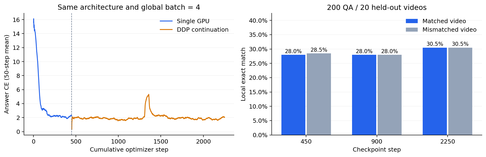

# 双卡延长训练：2026-11-05

从现有 450 步模型与 AdamW 状态恢复，两张 RTX 5090 新增 1800 步，累计 2250 步；按样本呈现累计约五轮。保持原有架构，无 JEPA，冻结两骨干，每段四帧、384×384、BF16、学习率 1e-4。每卡 batch=1/累积2，全局有效 batch=4，与原单卡相同。

数据仍为 180 个训练视频 / 1800 QA、20 个验证视频 / 200 QA，按视频隔离，没有加入新数据。恢复不包含 RNG 和数据迭代器状态，DDP 使用自己的固定种子采样顺序。

最终标准 EM 为 30.50%，450 步基线为 28.50%。但最终模型在视频错配后仍有 30.50% EM，只有 3.50% 的答案变化；增加训练轮数尚未建立可靠视觉依赖。下一步优先改进视觉对齐数据、训练策略与消融，而不把这次小幅点估计提升当作架构优势。



## 验证集与生成对照

| 累计步数 | 标准评测 EM | 标准评测 token F1 | 控制实验正确视频 EM | 控制实验错配视频 EM | 答案变化比例 | 配对 EM 差值的按视频 bootstrap 95% CI |
|---|---:|---:|---:|---:|---:|---|
| 450 | 28.50% | 30.48% | 28.00% | 28.50% | 7.50% | [-2.00%, +1.00%] |
| 900 | 28.00% | 29.26% | 28.00% | 28.00% | 6.00% | [-1.50%, +1.50%] |
| 2250 | 30.50% | 33.29% | 30.50% | 30.50% | 3.50% | [+0.00%, +0.00%] |

训练集多数答案 yes 的本地 EM 为 11%。这里是归一化词面完全匹配与 token F1，没有使用官方 ActivityNetQA judge，不与论文排行榜直接比较。

标准评测与配对控制的执行路径分别记录，没有假定逐位一致。例如 450 步的历史标准 EM 为 28.5%，本次配对控制正确视频 EM 为 28.0%，相差一题；两者均保留，未强行合并。控制实验差值和置信区间只使用同次配对结果。

视觉对照固定相同问题、答案、时间戳和帧数，将视频替换为另一验证视频；20 个视频按固定种子循环配对，三个 checkpoint 使用相同映射。生成不接收真实答案。置信区间按视频进行 5000 次成对 bootstrap，避免将同视频的十个问题当成十个独立视频；该区间仍不能支持跨数据集泛化结论。

| 累计步数 | 正确视频答案 CE | 错配视频答案 CE | 错配 − 正确 |
|---|---:|---:|---:|
| 450 | 2.1465 | 2.1463 | -0.0003 |
| 900 | 2.0369 | 2.0380 | +0.0011 |
| 2250 | 1.9404 | 1.9413 | +0.0009 |

## 延长训练的配对比较

使用标准评测保存的同一批预测，按视频成对 bootstrap，与 450 步基线比较：

| 累计步数 | 相对450步 EM 变化 | 按视频 bootstrap 95% CI |
|---|---:|---|
| 450 | +0.00% | [+0.00%, +0.00%] |
| 900 | -0.50% | [-4.00%, +2.50%] |
| 2250 | +2.00% | [-2.00%, +5.50%] |

区间跨零时，不把点估计的提升称为稳定或显著提升。验证集仅有20个独立视频，也不将本轮数据上的选择推广到其他场景。

## checkpoint 与资源

按上述三个点中的验证 EM、token F1、较早步数依次选择，当前 best.pt 指向 **2250 步**；选择依据见 outputs/llava-2b-ddp-5epochs-20261105/best_checkpoint.json。这是验证集选择，不是独立测试结果。

双卡新增训练作业耗时 18.9 分钟，末50步训练 CE 均值 2.0653。中途只读评测与训练共享 GPU0，所以耗时包含资源竞争，不用于单双卡吞吐对比。

| GPU rank | 峰值 allocated GiB | 峰值 reserved GiB |
|---|---:|---:|
| 0 | 6.44 | 6.55 |
| 1 | 6.43 | 6.56 |

PyTorch 显存统计按训练进程记录，不包括其他进程、CUDA context 等，不能直接等同于 nvidia-smi 总占用。

主目录：outputs/llava-2b-ddp-5epochs-20261105/。包含 run.json、metrics.jsonl、resources.json、torchrun 两个 rank 的日志、step-00900.pt、step-02250.pt、last.pt、best.pt 及两次验证/错配结果。2250 步与 last.pt 是同一文件的硬链接，不重复占用模型空间。

## 复现

```bash
env -u PYTHONPATH CUDA_VISIBLE_DEVICES=0,1 HF_HUB_OFFLINE=1 TRANSFORMERS_OFFLINE=1 uv run --locked torchrun --standalone --nproc_per_node=2 -m trace_vl train --config configs/local_2b_ddp_5epochs.yaml --resume outputs/llava-2b-baseline-cfr-epoch1-20261105/last.pt --output outputs/ddp-extension-reproduction
bash scripts/evaluate_ddp_milestone.sh outputs/ddp-extension-reproduction/step-02250.pt outputs/ddp-extension-reproduction/validation-final
```

本轮保持模型结构，只扩展 checkpoint 保留、双 rank 资源记录和诊断脚本。短视频结果不能证明长视频记忆或告警性能，数据和视觉对齐仍需后续专项实验。
