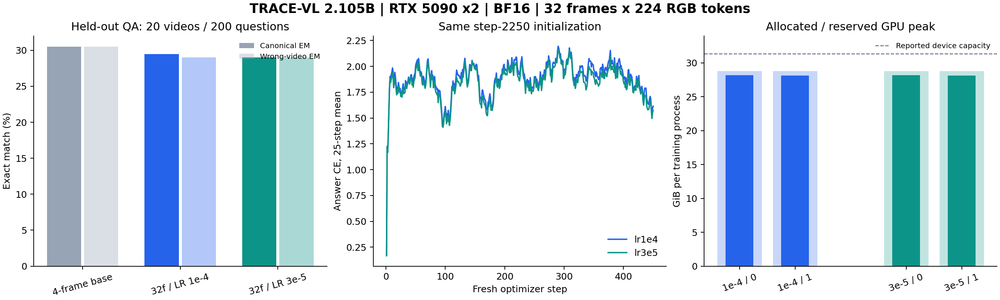

# 双卡高显存调参：2026-11-05

将每段输入从最多4帧提高到32帧，RGB token 从96提高到224，文本上限256提高到512。每卡 batch 从1提高到2，累积从2降到1，全局有效 batch 仍为4。保持384×384、BF16和两个冻结骨干，总参数2,104,675,891，可训练参数67,817,011。没有引入JEPA。

## 数值修复与实验边界

直接扩大序列时出现非有限梯度。激活审计显示旧2250步权重的工作状态最大绝对值由第1帧106.76增至第16帧约7.42e7；仅截断反向或提高新模块精度未解决。新增可选无参数LayerNorm，将门控工作状态和新胶囊归一化。两组新实验均开启normalize_memory，旧四帧基线保持关闭。因此新旧比较同时改变输入预算和归一化行为，不能归因于单个因素；两组新实验间仅学习率不同。

两组均从同一个2250步checkpoint独立初始化，seed=7，重建AdamW、步数归零，各训练450步，即1800条QA的一次呈现。--init-from与--resume分离，避免恢复旧优化器时覆盖新学习率。



## 结果

新配置中最高标准EM为29.50%，相对四帧基线-1.00个百分点。扩大输入预算没有在本轮获得更高验证EM。旧2250步checkpoint及其best链接保持原样；本目录best.pt仅在两组新配置之间选择。

| 配置 | 标准EM | token F1 | 正确视频EM | 错配视频EM | 答案变化 | 正确−错配EM 95% CI |
|---|---:|---:|---:|---:|---:|---|
| baseline-4frames | 30.50% | 33.29% | 30.50% | 30.50% | 3.00% | [+0.00, +0.00] pp |
| lr1e4 | 29.50% | 31.73% | 29.50% | 29.00% | 2.50% | [+0.00, +1.50] pp |
| lr3e5 | 29.00% | 31.20% | 29.00% | 29.00% | 3.00% | [+0.00, +0.00] pp |

| 新配置 | 相对四帧基线EM | 按视频bootstrap 95% CI | 错配−正确答案CE |
|---|---:|---|---:|
| lr1e4 | -1.00 pp | [-3.50, +1.50] pp | -0.003154 |
| lr3e5 | -1.50 pp | [-4.00, +1.00] pp | -0.000629 |

两组新配置按验证EM、token F1、较低学习率依次选择，best.pt指向lr1e4。这是验证集选择，不是独立测试结果。当前测得的分数与视觉错配差值应分别判断；不能由更高显存占用推断模型已学会看视频。

本轮正确/错配视频得分仍接近，答案变化比例仅约几个百分点，视觉依赖依然很弱。末50步训练CE下降也未对应更高验证EM。下一轮应优先排查视觉对齐数据、语言先验和前缀融合训练，加入受控视觉监督与对应消融；现有结果不足以定位唯一原因。记忆归一化解决了长展开数值稳定性，但不是问答效果提升的证据。

## 显存与容量边界

| 新配置 | rank | allocated GiB | reserved GiB | 分配GB | 训练分钟 |
|---|---:|---:|---:|---:|---:|
| lr1e4 | 0 | 28.16 | 28.79 | 30.23 | 12.01 |
| lr1e4 | 1 | 28.14 | 28.78 | 30.22 | 12.01 |
| lr3e5 | 0 | 28.16 | 28.79 | 30.23 | 12.12 |
| lr3e5 | 1 | 28.14 | 28.78 | 30.22 | 12.12 |

| 容量探测 B×T×RGB tokens | 归一化 | 精度 | detach间隔（0=不截断） | 结果 | 峰值allocated GiB |
|---|---|---|---:|---|---:|
| 2×16×192 | False | bf16 | 8 | nonfinite_gradient | 13.12 |
| 2×16×192 | False | fp32 | 0 | nonfinite_gradient | 19.75 |
| 2×16×192 | True | bf16 | 0 | ok | 13.64 |
| 2×16×192 | False | bf16 | 0 | nonfinite_gradient | 13.13 |
| 2×16×96 | False | bf16 | 8 | nonfinite_gradient | 8.43 |
| 2×32×224 | True | bf16 | 0 | ok | 27.87 |
| 2×4×96 | False | bf16 | 0 | ok | 6.61 |
| 4×16×192 | True | bf16 | 0 | ok | 21.90 |
| 4×16×256 | True | bf16 | 0 | oom | 28.69 |
| 5×16×192 | True | bf16 | 0 | ok | 25.94 |
| 8×16×192 | True | bf16 | 0 | oom | 28.37 |

探测采用每进程92% allocator上限，OOM表示触及本次探测预算，不是理论硬件极限。表中fp32指关闭autocast，新模块采用FP32，冻结Qwen仍按存储dtype加载，并非全模型转为FP32。早期探测未显式记录的归一化、精度和detach设置由其保存配置的默认值恢复。正式DDP不设置allocator上限；资源表为各训练进程PyTorch峰值，不含CUDA context和其他进程。GB=10^9 bytes，GiB=2^30 bytes。

## 数据与复现

沿用180训练/20验证视频，1800/200 QA，来源视频隔离；只有QA监督，不含告警标签。更密集解码审计发现一条验证MP4帧索引失败，另存CFR修复副本，涉及同视频10题；原始媒体与旧manifest保留，新旧三组评测统一使用llava-pilot-tuning-cfr.jsonl。2000条记录的问题、答案、来源组、划分及观测窗口逐项核对保持一致；未增加训练数据。

标准评测和错配控制均覆盖200题。控制仅更换另一个验证视频的像素，保持目标问题/答案/时间戳/帧数；生成不接收答案。相同观测前缀可复用问题无关状态，测试确认复用不改变答案和证据。所有置信区间按20个视频进行5000次成对bootstrap。这里是本地归一化词面EM/token F1，不是官方ActivityNetQA judge，也未评估监控告警或长期记忆。

```bash
env -u PYTHONPATH CUDA_VISIBLE_DEVICES=0,1 HF_HUB_OFFLINE=1 TRANSFORMERS_OFFLINE=1 uv run --locked torchrun --standalone --nproc_per_node=2 -m trace_vl train --config configs/tuning/high_memory_lr3e5.yaml --init-from outputs/llava-2b-ddp-5epochs-20261105/best.pt --output outputs/high-memory-reproduction
bash scripts/evaluate_ddp_milestone.sh outputs/high-memory-reproduction/last.pt outputs/high-memory-reproduction/val configs/tuning/high_memory_lr3e5.yaml
```

测试：46 passed、2 skipped；ruff通过。容量探测、激活审计、媒体修复与两个rank的完整训练日志均在outputs/tuning-20261105/。JSON报告保留checkpoint与manifest哈希。
