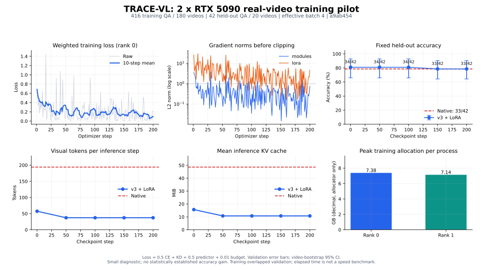

# TRACE-VL 本机200步训练与A100交付报告（2026-11-07）

双5090真实视频训练、5个检查点重载验证和90题跨任务回归均已完成。训练稳定并减少了视觉token/KV；42题留出集没有出现准确率提升。Video-MME小子集出现正向变化，仍不足以证明模型架构优势。

## 配置与训练结果

- 训练代码：`a9ab454`；云端交付代码：`d8b2601`。后者修复MC问题ID；训练/模型/读取器/UV锁文件的对应内容已核对不变。
- Qwen3.5-2B多模态骨干，固定模型版本 `15852e8c16360a2fea060d615a32b45270f8a8fc`；冻结骨干，训练CST/转移编码相关模块与LoRA。当前数据不含告警监督，告警分类头不在本轮训练目标内。
- 416条训练问答、180视频；42条留出问答、20视频，按视频隔离。答案Yes/No数量接近均衡。
- 2卡、每卡累积2，有效batch 4；200次优化器更新，共800次有放回抽样。输入覆盖完整视频，最长29.93秒；448²像素预算，CST 4层/768维/窗口16。
- 两卡峰值allocated：**7.381 / 7.137 GB**。含加载约 **13.85 分钟**，与验证并行，不能外推为A100速度。
- Rank 0加权训练loss前20步均值 **0.3766**，末20步 **0.1249**；所有记录loss/梯度有限。loss下降不等于验证准确率提高。

## 固定留出集（同42题，五个成对检查点）

| 方法/检查点 | 正确数 | 准确率 | 视觉tokens/step | 平均KV MiB |
|---|---:|---:|---:|---:|
| native | 33/42 | 78.57% | 193.86 | 48.61 |
| step-00000 | 34/42 | 80.95% | 57.41 | 15.65 |
| step-00050 | 34/42 | 80.95% | 37.18 | 10.75 |
| step-00100 | 34/42 | 80.95% | 37.18 | 10.75 |
| step-00150 | 33/42 | 78.57% | 37.18 | 10.75 |
| step-00200 | 33/42 | 78.57% | 37.18 | 10.75 |

最终视觉token较原生减少 **80.8%**，KV减少 **77.9%**；准确率维持原生33/42。初始化的压缩模型已有34/42，因此本轮不能声称训练改善了该留出集效果。0/50/100/150/200步均保存模块与LoRA的配对检查点，并实际重载评测。

## Video-MME诊断回归

固定30个视频/90题，覆盖short/medium/long，无字幕、non-thinking、最多80个双帧时间步、每帧448²像素预算，使用一致的FP32字母打分。不是全量benchmark；也不同于前一轮官方处理器默认采样的一致性检查。最终200步检查点在评测前指定，未按benchmark结果挑选。

| 方法 | 正确数 | 准确率 | 视觉tokens/step | 平均KV MiB |
|---|---:|---:|---:|---:|
| native | 47/90 | 52.22% | 190.33 | 184.66 |
| untrained-step0 | 44/90 | 48.89% | 51.87 | 57.00 |
| trained-step200 | 50/90 | 55.56% | 30.88 | 37.65 |

最终模型相对原生提高 3.33 个百分点，按视频配对bootstrap的95%区间为 **[-7.78, 13.33] 个百分点**；相对初始化压缩模型为 6.67 个百分点，区间 **[-2.22, 15.56]**。样本小，且没有同token预算池化消融，不能据此归因于架构创新或宣称领先。

## 本轮发现并处理的数据问题

1. 原版选择题转换器将官方5,496道题转换成仅1,296个唯一ID。作者已在d8修复；实测为5,496条/5,496个唯一ID，完整CPU/CUDA测试 **90 passed**。
2. 冻结的本机训练清单中补充发现一个单轮表示下的冲突问题组：2条训练记录，留出集无冲突。为保持已启动实验可复现，主实验清单未中途改动；结果作为有此限制的诊断。A100清洗入口会删除冲突组并记录数量。
3. 一个原视频的尾帧随机寻址失败，本机使用已存在且再次验证通过的CFR衍生文件，保留原件。云端准备脚本审计所有引用视频的首尾解码和长度，并记录排除项。
4. 云端启动脚本已在本机用清洗数据进行双卡两步演练，包括数据审计、DDP、逐卡资源记录及成对检查点。A100硬件尚未实测。

## 交付与边界

- A100步骤：`A100_TRAINING_GUIDE.md`；代码包：`TRACE-VL-A100-d8b2601-20261107.tar.gz`。
- 实验分支：`experiment/stage1-local-a100-20261107`，含固定d8源码及配套脚本。
- 全部指标/配对置信区间/预测/数据与代码哈希：`local_training_results_20261107.json`。
- 训练日志及检查点：`train-ddp-200/`；验证：`validation/`；benchmark：`videomme/`。
- 当前检查点不含optimizer/RNG完整状态，重启是权重热启动；Stage 2长流训练和真实物业告警误报/漏报评测尚未完成。

正式A100实验应使用清洗后的原生多选题，先100步校准，再按固定方案训练并比较全token、同预算池化和TRACE-VL。当前结果支持继续做规模化实验，尚未构成论文效果结论。
